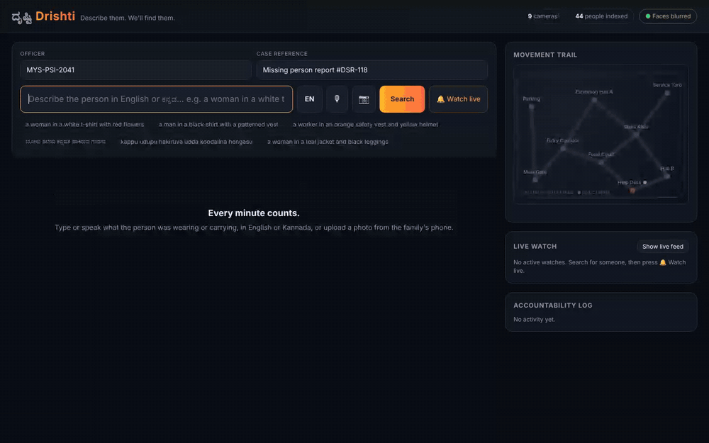
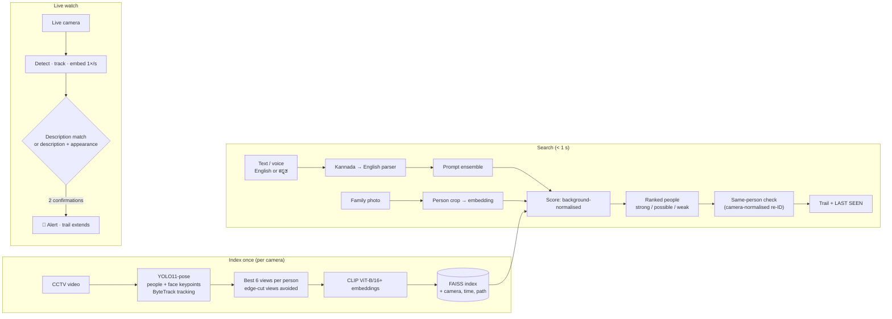

<div align="center">

# ದೃಷ್ಟಿ Drishti

### Describe them. We'll find them.

**Find a missing person in hours of multi-camera CCTV in seconds, from a description in English or Kannada, or a family photo, and get an alert the moment they walk past a live camera. No face recognition.**

[](https://github.com/bharathibr-123/drishti/actions/workflows/ci.yml)




</div>

---

## The problem

At a crowded event such as Mysuru Dasara, a parent tells police: *"My son is 6. Yellow t-shirt, blue shorts, holding a red balloon."* Today officers find him by **scrubbing CCTV by hand**, one camera at a time. Face-recognition systems need a clear photo of the face, which a frightened parent often doesn't have, and they keep a database of everyone's face.

## What Drishti does

| | |
|---|---|
| 🔎 **Search by description** | *"a woman in a white t-shirt with red flowers"*: every person on every camera is ranked in under a second. |
| 🗣️ **Kannada and Kanglish** | *"ಬಿಳಿ ಹೂವಿನ ಟೀ ಶರ್ಟ್ ಹಾಕಿರುವ ಹೆಂಗಸು"* or *"haladi t-shirt hakiruva huduga"*, typed or spoken. An offline parser turns them into English for the vision model. |
| 📷 **Search by photo** | Upload a photo from the family's phone. Drishti finds the person in it and searches for them. |
| 🗺️ **Cross-camera trail** | Sightings that pass a **same-person check** are joined in time order on the site map, ending at **LAST SEEN**. |
| 🔔 **Live watch** | Register a description once. When that person appears on a live camera you get an alert, and the trail extends to a **LIVE** last-seen point. |
| 🛡️ **Privacy by design** | No face recognition. Faces are **blurred by default**, located with pose keypoints so close-ups are covered too. Every search, unblur and footage view needs an officer ID and case number, and goes to an audit log. |

## Results

Measured on our [person-level benchmark](eval/benchmark.json): **30 descriptions** (6 in Kannada or romanised Kannada), **8 cameras, 44 people**, CPU only. Every person who fits each description is labelled, and a result counts only if it is that exact person. Full report: [`eval/RESULTS.md`](eval/RESULTS.md). Reproduce it with `python -m drishti.evaluate`.

| | Recall@1 | Recall@5 | MRR | LAST SEEN correct |
|---|---|---|---|---|
| Plain CLIP | 67% | 97% | 0.80 | 66% |
| **Drishti** | **80%** | **100%** | **0.87** | **79%** |

| Kannada / Kanglish queries | Recall@1 | Recall@5 |
|---|---|---|
| Raw text sent to the vision model | 0% | 33% |
| **With Drishti's offline translator** | **83%** | **100%** |

- **Cross-camera re-identification:** all 7 people who appear on two cameras score above the same-person threshold (0.35–0.68 against 0.30), while every pair of different people scores ≤ 0.25.
- **Live alerts:** in our test, both people on the live camera were caught within seconds, with **zero false alerts** across five watches.
- **Speed (2-core cloud CPU):** 0.3–0.6 s per new text search, about 1 ms for a repeated one, and 9.5 minutes of footage from 8 cameras indexed in about 10 minutes. Live cameras use no CPU until a watch is registered or the feed is opened.

## How it works



**The ideas that make it work, each measured** (see the ablation in [`eval/RESULTS.md`](eval/RESULTS.md)):

1. **Prompt ensemble + background normalisation, together.** The description is embedded in several CCTV-style phrasings, then half of each person's similarity to a generic *"a person"* prompt is subtracted. That stops large, sharp crops from winning every search. Each idea alone does nothing (63% and 67% Recall@1); **together they take Recall@1 from 67% to 80%**.
2. **Camera-normalised re-identification.** Raw CLIP vectors of two *different* people on the same camera are about 0.85 similar, because they share background and lighting. Subtracting each camera's average look leaves what differs between people. That powers the same-person check for trails (7/7 cross-camera links), the "also seen on other cameras" panel and live appearance matching.
3. **An offline Kannada parser.** A tagged lexicon (colours, clothes, people, verbs, with romanised spellings) plus a rule-based subject-object-verb → English rewrite. No API and no internet: CLIP can't read Kannada at all (0% Recall@1), and the parser takes it to 83%.
4. **Calibrated live alerts.** A live score is judged against how the same query scores across the whole archive, and needs two consecutive confirmations. If the archive search already found the person, a moderate description match **plus** an appearance match also counts. That catches close-up live views that describe poorly.

### What we tried that did *not* help, so it is off or removed
| Idea | Result | Decision |
|---|---|---|
| All-attributes AND scoring (soft-min over "boy" + "yellow t-shirt" + "red balloon") | Recall@1 80% → 77% | kept as an option, **off by default** |
| Background masking with segmentation | fixed some queries, broke others | option, **off by default** |
| Stitching broken tracks by appearance | the same person front-on vs from behind looked too different; it would merge strangers | **removed** |
| BoT-SORT tracker with re-ID | identical tracks to ByteTrack on our footage | **not used** |
| CLIP ViT-B/32 and ViT-B/16 instead of ViT-B/16+ | lower Recall@1 in our earlier, coarser benchmark | B/16+ is the default |

## Quick start

Needs **Python 3.10–3.12** and about 3 GB of disk space.

```bash
git clone https://github.com/bharathibr-123/drishti.git && cd drishti
python -m venv .venv
.venv\Scripts\activate            # Windows   (macOS/Linux: source .venv/bin/activate)
pip install -r requirements.txt

python scripts/setup_demo.py                  # model weights (~850 MB) + 9 demo videos
python -m drishti.ingest demo/cameras.json    # build the index: ~10 min on a laptop CPU
uvicorn app.server:app --port 8000            # open http://localhost:8000 in Chrome
```

**Try it:** click a chip, or type *a man in a black shirt with a patterned vest*. To see the live alert, search *a man in a dark blue t-shirt* and press **🔔 Watch live**: an alert arrives from the Help Desk camera within about 10 seconds. Press **EN** to switch the microphone to **ಕನ್ನಡ**.

Other ways to run it: `make setup index run`, or the included `Dockerfile` (experimental: `docker build -t drishti . && docker run -p 8000:8000 drishti`). `make check` runs what CI runs: ruff, strict mypy and 35 tests. On a slow laptop, `set DRISHTI_CLIP_ARCH=ViT-B-32-quickgelu` before indexing uses a model about 3× faster (its weights download automatically) at some cost in accuracy.

### Use your own footage
Add cameras to [`demo/cameras.json`](demo/cameras.json): `id`, `name`, `video`, `start_time` (ISO time, or `-HH:MM:SS` for "this long before the app started"), and `x`, `y` on the site map. Add `"live": true` for a camera that should be watched instead of indexed. Walkways for the map go in [`demo/site.json`](demo/site.json). Then re-run the ingest.

## Responsible AI
- **Describes clothing, never identity.** There is no face recognition and no face database.
- **Faces are blurred by default:** in thumbnails, context frames, live feeds and alert snapshots. Head regions come from pose keypoints, falling back to the top of the person box.
- **Purpose-bound access.** Every search, watch, unblur and footage view needs an officer ID and case reference, and is appended to `data/audit_log.jsonl`. The API rejects requests without them (tested).
- **Stays on-premise.** Every model runs locally, with no cloud calls, so no footage leaves the control room.

## Limitations (honest)
- **Small benchmark.** 30 descriptions on public demo footage. Score weights and thresholds were tuned on this same set, so a larger held-out evaluation (for example WILDTRACK, or our own campus recordings) is the next step.
- **Fine patterns are hard for CLIP.** "Stripes on the sleeves" and "checked shirt" rank 4th–5th.
- **Not yet tested** on night footage, rain, or very dense crowds. The demo footage contains no children.
- **Live mode** replays a video file as a camera. Plugging in an RTSP stream URL is a one-line change in `drishti/live.py`.

## Project structure
```
drishti/                 core library (strict mypy)
  ingest.py              video → people → views → embeddings (+ head boxes, paths)
  query.py, kannada.py   query understanding: language detection, Kannada → English
  scoring.py             pure-numpy scoring (unit-tested, ablated in evaluate.py)
  search.py              SearchEngine: text / photo search, re-ID "similar"
  trail.py               same-person check + cross-camera trail
  live.py                live watch: calibrated alerts on camera streams
  privacy.py             head location from pose keypoints, blurring
  store.py               on-disk index, FAISS, camera-normalised appearance
  evaluate.py            benchmark + ablation → eval/RESULTS.md
app/                     FastAPI server + control-room UI (HTML/CSS/JS, no build step)
eval/benchmark.json      person-level ground truth
tests/                   35 tests: query, Kannada, scoring, trail, privacy, API guards
```

## API
| Endpoint | Purpose |
|---|---|
| `POST /api/search` | `{query, officer, reason}` → ranked people, trail, last seen, `understood_as` |
| `POST /api/search_image` | multipart `file` (+ optional `query`) → same |
| `GET /api/similar/{track}` | re-identification: likely the same person on other cameras |
| `POST /api/watch` · `GET /api/events` | register a live watch · server-sent alert stream |
| `GET /api/live/{camera}.mjpg` | live feed, faces blurred, matches boxed |
| `GET /api/thumb/{id}` · `/api/frame/{id}` | blurred images (`?reveal=1` needs a case reference and is logged) |
| `GET /api/audit` | accountability log |

## Credits and license
Demo videos: [Intel IoT DevKit sample videos](https://github.com/intel-iot-devkit/sample-videos), CC BY 4.0; the venue layout and camera names are fictional. Models: [Ultralytics YOLO11](https://github.com/ultralytics/ultralytics) (AGPL-3.0), [OpenCLIP](https://github.com/mlfoundations/open_clip) with LAION-400M weights. Drishti is released under **AGPL-3.0**.

Built for **Resurrect – Hybrid Innovation Challenge 2026**, Open Innovation track.
